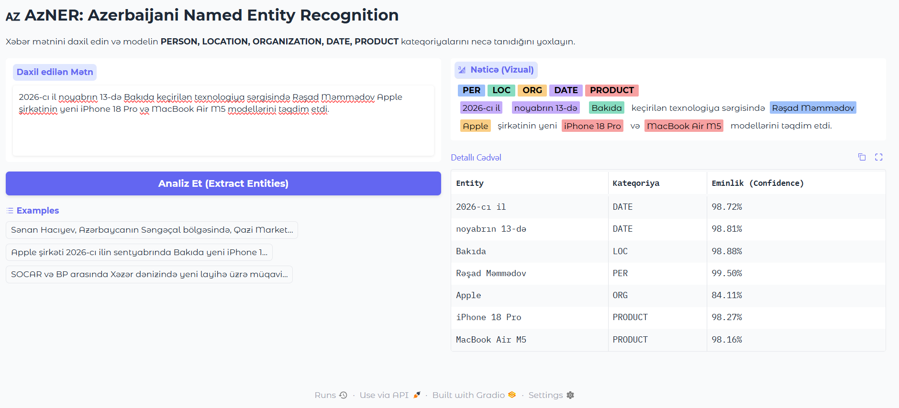

# 🇦🇿 AzNER: End-to-End Named Entity Recognition for Azerbaijani

An end-to-end Named Entity Recognition (NER) system fine-tuned on **XLM-RoBERTa** for the Azerbaijani language. Designed specifically to handle morphologically rich (agglutinative) text, severe class imbalance, and low-resource constraints, the model extracts five core entity types: **`PERSON`**, **`LOCATION`**, **`ORGANIZATION`**, **`DATE`**, and **`PRODUCT`**.

---

## 🎯 Key Highlights & Engineering Achievements

* **High Performance on Minority Classes:** Achieved **0.92 F1-score** on `PRODUCT` (despite representing only 7.9% of total entities) and **0.85 Weighted Avg F1-score** across all categories using custom **Smoothed Inverse-Frequency Class Weighting**.
* **Custom Regex-to-BIO Alignment Engine:** Built a mathematical character-span intersection pipeline (`convert_to_bio.py`) with automated validation checks for nested/overlapping spans and BIO sequence integrity.
* **Train-Inference Subword Consistency:** Solved subword fragmentation issues inherent to agglutinative languages (e.g., `"Sənan"` → `["▁Sən", "an"]`) by aligning `-100` ignore-index masking during training with `first`-subword aggregation and gap-merging post-processing at inference.
* **Resource-Efficient Local Training:** Optimized for consumer-grade hardware (**NVIDIA GTX 1650, 4GB VRAM**) using FP16 Mixed Precision, gradient accumulation, and aggressive regularization (`Dropout=0.25`, `Weight Decay=0.05`) to prevent overfitting on a 833-sentence dataset.

---

## 📊 Evaluation Results (Unseen Test Set)

Evaluated on a strictly held-out, stratified test set (**85 sentences / 261 entities**) using token-level `seqeval` metrics:

| Entity Type | Precision | Recall | F1-Score | Support |
| :--- | :---: | :---: | :---: | :---: |
| **PRODUCT** | **0.90** | **0.95** | **0.92** | 19 |
| **PER** (Person) | 0.90 | 0.94 | **0.92** | 50 |
| **LOC** (Location) | 0.88 | 0.88 | **0.88** | 104 |
| **DATE** (Date) | 0.71 | 0.89 | **0.79** | 27 |
| **ORG** (Organization) | 0.63 | 0.87 | **0.73** | 61 |
| **Micro Avg** | 0.79 | 0.90 | **0.84** | 261 |
| **Macro Avg** | 0.80 | 0.91 | **0.85** | 261 |
| **Weighted Avg** | **0.81** | **0.90** | **0.85** | **261** |

> **Analytical Takeaway:** Higher recall (`0.90`) over precision (`0.79`) reflects the intentional design of our weighted loss function, ensuring rare domain entities like `PRODUCT` are reliably captured rather than defaulted to the majority `O` (Outside) class.

---

## 🏗️ End-to-End Architecture & Workflow

```text
[Label Studio Raw JSONs] 
       │
       ▼ (1. Regex Tokenization & Span Intersection)
[BIO Format Conversion & Integrity Validation] 
       │
       ▼ (2. Exact Deduplication & Entity-Aware Stratified Split)
[Train (624) / Val (124) / Test (85)]
       │
       ▼ (3. Subword Alignment + Weighted Cross-Entropy + Dropout 0.25)
[Fine-Tuned XLM-RoBERTa Model (FP16 on GTX 1650)]
       │
       ▼ (4. First-Subword Aggregation & Contiguous Span Merging)
[CLI Inference & Gradio Web UI]
```

### 1. Data Engineering & BIO Alignment (`src/convert_to_bio.py`)
* **Annotation Source:** 834 sentences annotated via **Label Studio** across two collection batches (news articles and general domain sentences).
* **Character-Span Alignment:** Implemented regex-based tokenization (`\w+|[^\w\s]`) supporting Azerbaijani diacritics (`ə, ı, ğ, ş, ç, ö, ü`) and mapped character offsets to `BIO` tags (`B-PER`, `I-PER`, etc.).
* **Automated Quality Assurance:**
  * Detects and flags overlapping/nested annotations.
  * Verifies exact mathematical parity between raw annotated spans and generated `B-` tags.
  * Enforces valid BIO transitions (ensuring `I-X` never follows `O` or a mismatched `B-Y`).

### 2. Deduplication & Stratified Splitting (`src/prepare_combined_data.py`)
* **Deduplication:** Normalized whitespace and casing to eliminate duplicate sentences across merged JSON exports, preventing data leakage between train and evaluation splits (yielding **833 unique sentences**).
* **Entity-Aware Stratification:** Because `PRODUCT` appeared in only 16% of sentences (195 total instances), a naive random split risked starving the validation/test sets. We implemented a custom stratified splitter that preserves the exact ~8% `PRODUCT` distribution across **Train (75%)**, **Validation (15%)**, and **Test (10%)**.

### 3. Model Training & Regularization (`src/train_ner.py`)
* **Base Model:** `xlm-roberta-base` selected for its strong multilingual subword vocabulary covering Turkic morphology.
* **Subword Label Alignment:** Mapped word-level tags to subword tokens via `word_ids()`. Assigned original tags to the first subword and `-100` (PyTorch `CrossEntropyLoss` ignore index) to subsequent subwords and special tokens (`<s>`, `</s>`).
* **Handling Class Imbalance:** Implemented a custom `WeightedNERTrainer` subclassing Hugging Face `Trainer`. Computed smoothed inverse-frequency weights (`power=0.35`, clipped at `5.0`), assigning `1.00` to `O`, `2.76` to `B-LOC`, and `4.62` to `B-PRODUCT`.
* **Overfitting Prevention:**
  * Increased `hidden_dropout_prob` and `attention_probs_dropout_prob` from `0.1` to **`0.25`**.
  * Applied `weight_decay=0.05`, `learning_rate=3e-5`, and `EarlyStoppingCallback(patience=3)`.
* **Hardware Optimization:** Trained locally on an **NVIDIA GeForce GTX 1650 (4GB VRAM)** using `fp16=True`, `max_length=128`, `per_device_train_batch_size=8`, and `gradient_accumulation_steps=2` (effective batch size = 16).

### 4. Inference & Subword Post-Processing (`src/inference.py` & `app.py`)
* Standard token classification pipelines often split agglutinative Azerbaijani words into fragmented entities (e.g., `"Sənan"` → `"Sən"` + `"an"`).
* Enforced **Train-Inference Consistency** by pairing `aggregation_strategy="first"` with a custom post-processing merger (`clean_and_merge_entities`) that stitches contiguous same-class subwords directly from original character offsets.

---

## 📁 Repository Structure

```text
azner/
├── src/
│   ├── convert_to_bio.py          # Regex tokenization, span-to-BIO alignment, and QA checks
│   ├── prepare_combined_data.py   # Multi-file merging, deduplication, and stratified splitting
│   ├── train_ner.py               # Custom WeightedNERTrainer, dropout config, and training loop
│   ├── evaluate.py                # Standalone test evaluation and JSON metric exporter
│   └── inference.py               # CLI inference with subword gap-merging post-processing
├── app.py                         # Interactive Gradio web application
├── final_az_ner_model/            # Saved model weights, config, and tokenizer
├── train.json / val.json / test.json
└── README.md
```

---
## 🖥️ Live Demo Preview



## 🚀 Quickstart & Usage

### 1. Installation
```bash
git clone https://github.com
cd azner
python -m venv .venv
source .venv/bin/activate  # On Windows: .venv\Scripts\activate
pip install torch transformers datasets seqeval accelerate scikit-learn gradio
```

### 2. Data Preparation & Training
```bash
# Merge, deduplicate, and split Label Studio exports
python -m src.prepare_combined_data

# Train the model with weighted loss and FP16 mixed precision
python -m src.train_ner

# Generate standalone evaluation report
python -m src.evaluate
```

### 3. Running Inference (CLI & Web UI)
```bash
# Run CLI predictions on sample sentences
python -m src.inference

# Launch interactive Gradio demo (http://127.0.0.1:7860)
python app.py
```

### Example Output
**Input:**
> *"Sənan Hacıyev, Azərbaycanın Səngəçal bölgəsində, Qazi Marketdən Asus Tuf F15 aldı."*

**Extracted Entities:**
* **`Sənan Hacıyev`** $\rightarrow$ `PER` *(Confidence: 99.52%)*
* **`Azərbaycanın`** $\rightarrow$ `LOC` *(Confidence: 98.64%)*
* **`Səngəçal`** $\rightarrow$ `LOC` *(Confidence: 98.21%)*
* **`Qazi Marketdən`** $\rightarrow$ `LOC` *(Confidence: 95.16%)*
* **`Asus Tuf F15`** $\rightarrow$ `PRODUCT` *(Confidence: 98.62%)*

---

## 🔮 Future Improvements
* **Morphological Lemmatization:** Integrate an Azerbaijani morphological analyzer post-NER to strip inflectional suffixes (e.g., normalizing `"Azərbaycanın"` $\rightarrow$ `"Azərbaycan"`) for downstream knowledge graph linking.
* **Data Augmentation:** Expand training samples for nested parenthetical abbreviations (e.g., `"Türk Hava Yolları (THY)"`) and foreign geographical entities.
